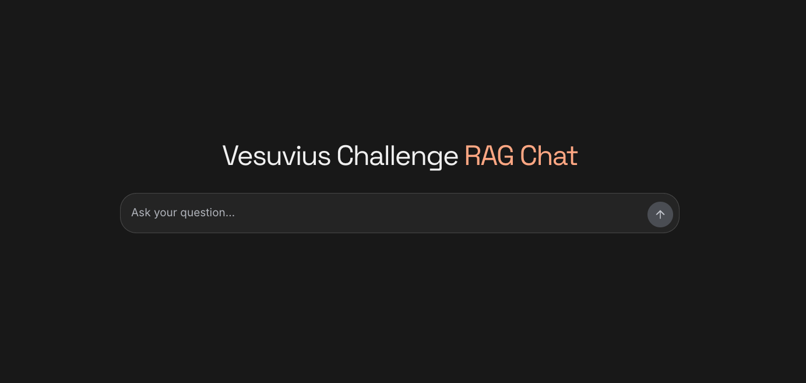

# Vesuvius RAG Chat

[](LICENSE)
[](docs/verification.md)
[](docs/verification.md)

Search your Discord research archive through a web chat or your AI agent.
Self-host the complete stack with Docker and your own API keys.



## Quick start

Requires **Docker with Compose v2**, an authorized Discord bot, and an OpenRouter key.

```sh
git clone https://github.com/LimeGS/vesuvius-chat.git
cd vesuvius-chat
cp docker/.env.example docker/.env
chmod 600 docker/.env
```

Edit `docker/.env` and set:

```dotenv
DISCORD_TOKEN=your-discord-bot-token
DISCORD_GUILD_ID=your-server-id
DISCORD_CHANNEL_IDS=channel-id,another-channel-id
OPENROUTER_API_KEY=your-openrouter-api-key
OPENROUTER_MODEL=your-chosen-model-id
```

Then run:

```sh
docker compose --env-file docker/.env up --build -d
```

Open **https://localhost:8443**. On first launch, models download and the initial
index builds; retrieval becomes available when that finishes. Allow several GB of
disk space and RAM. Initial history collection can take time.

The local HTTPS certificate and invitation code are generated automatically:

```sh
docker compose --env-file docker/.env cp proxy:/tls/tls.crt docker/localhost.crt
docker compose --env-file docker/.env cp app:/state/access.json docker/access.local.json
chmod 600 docker/access.local.json
```

Trust the exported certificate for this local installation. Open the access file
privately for your invitation code; **never share or commit it**. For bot permissions,
GPU setup, backups and public HTTPS hosting, see [self-hosting](docs/self-hosting.md).

## What it does

- **Hybrid retrieval:** BM25 + multilingual E5 embeddings, Reciprocal Rank Fusion
  and two cross-encoder rerankers, with surrounding conversation context.
- **Automatic refresh:** Discord ingestion runs every 30 minutes after initial setup.
- **Research tools:** date/author/channel filters, chronological pagination, original
  messages and thread context, with source links and posting dates.
- **Agent access:** authenticated, read-only Streamable HTTP at `/mcp`.
- **Access controls:** invitation codes, persistent quotas and bounded requests.
- **CPU by default**, with an optional NVIDIA GPU Compose configuration.

## Connect your agent

Use `https://localhost:8443/mcp` with the invitation code as a bearer token.
For a remote installation, use your own HTTPS host instead.

See [Claude Code, Codex and OpenCode setup](docs/mcp.md). Your agent supplies its
own model; MCP retrieval does not call OpenRouter. This is header-token
authentication, not OAuth or an anonymous endpoint.

## Development and checks

Requires Node.js **24.13+**. Python backend tests use Python **3.11 or 3.12**.

```sh
npm run install:ci
npm run test:coverage
npm run lint
npx tsc --noEmit
npm run build
npm audit
npm run check:publication
```

[CI](.github/workflows/quality.yml) enforces **90% coverage in lines, statements,
branches and functions**, plus build, audit and source-publication checks. Badges
are dated verification snapshots, not claims that a future audit always passes.
See [verification results](docs/verification.md) and [security guidance](SECURITY.md).

Optional offline Docker integration: `node scripts/check-docker.mjs`. It builds
its own test images from this checkout and uses synthetic providers and messages.

## Privacy and limits

Your keys and indexed Discord data stay in your installation's environment and
Docker volumes, not in this repository or its images. Chat generation sends your
question and retrieved evidence to your selected OpenRouter provider; its terms
and retention policies apply. Only index channels you are permitted to access.

Search results are bounded samples, not proof that a topic never appeared. Chat
research reviews at most 100 messages per turn and retains at most five sources;
busy-day highlights are therefore not a complete day-wide ranking. Relative dates
use `CHAT_TIME_ZONE`, defaulting to UTC rather than the browser's local timezone.
Full historical edit/deletion reconciliation and forum-parent discovery are not supported.
Stop with `docker compose --env-file docker/.env down`; **do not add `-v`** unless
you intend to erase stored data and credentials.

## License

Original project code is [MIT licensed](LICENSE). Fonts, dependencies and downloaded
models retain their own licenses; see [third-party notices](THIRD_PARTY_NOTICES.md).
